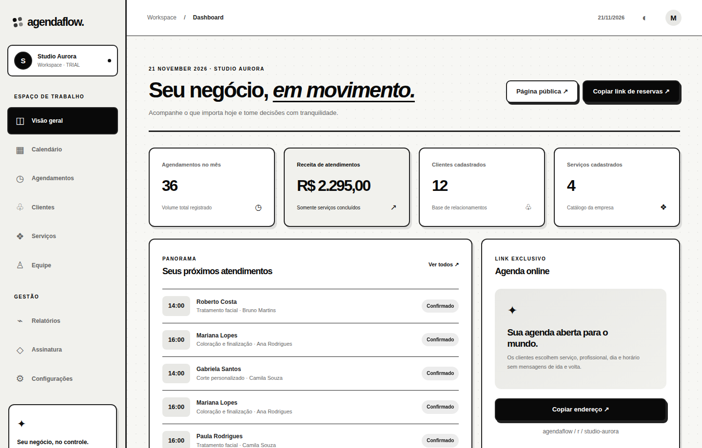
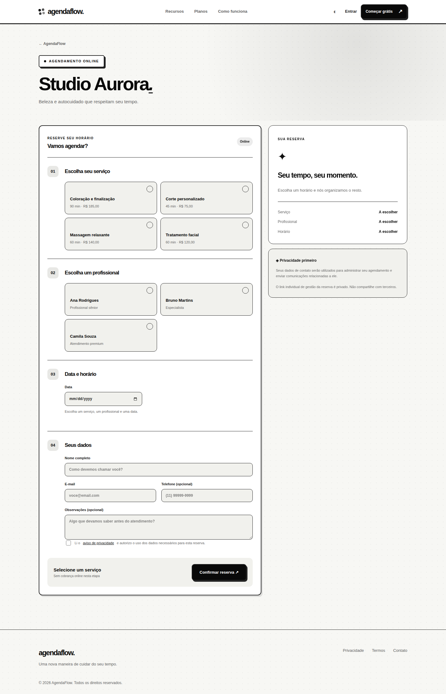
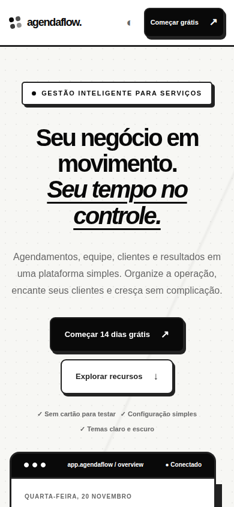
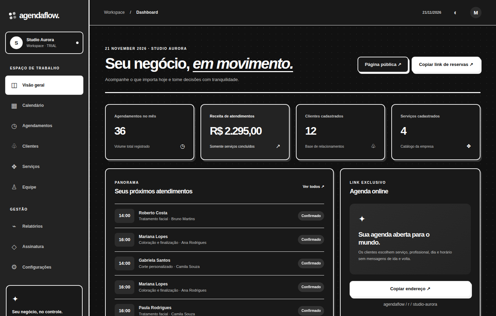

<div align="center">

# AgendaFlow SaaS

**Agendamentos, equipe e reservas em uma plataforma multiempresa.**


**[Perfil no GitHub](https://github.com/tteukkkk)** · **[Screenshots](#capturas-do-projeto)** · **[Como executar](#como-executar)**

<a href="previews/painel-claro.png"></a>

</div>

> **Status:** v2.0 · candidato a piloto; ainda não homologado para produção comercial. Dados e contas de demonstração são fictícios. O repositório apresenta um aplicativo local, não um serviço publicado na internet.

## Capturas do projeto

| Funcionalidade | Versão mobile |
| :---: | :---: |
|  |  |

As demais telas (landing page, painel, relatórios, configurações e outras) estão em [`previews/`](previews/).

## Como executar

A seção técnica abaixo contém pré-requisitos, instalação, inicialização, testes e observações de segurança. Para uma instalação mais simples no Windows, consulte também as instruções de cada projeto.

---


**AgendaFlow** é uma aplicação de gestão de agendamentos projetada para ser oferecida como software por assinatura a estabelecimentos de serviços. É a evolução arquitetural da versão acadêmica v1: interfaces responsivas com temas claro/escuro, área administrativa autenticada, reserva pública e infraestrutura para planos e cobrança.

> **Status:** versão candidata a piloto. Backend real, interface e testes automatizados; **não homologada para vendas em produção** até executar os itens de [Lançamento](docs/LANCAMENTO.md). Não use os logins fictícios em produção.

## Prévia

| Painel claro | Painel escuro |
| --- | --- |
|  |  |


Capturas geradas a partir do HTML renderizado pelo FastAPI e dados fictícios. São prévias reais da interface, não fotografias de uma implantação pública.

## O que está implementado

- **Multiempresa:** cada organização tem endereço, configurações, assinatura, membros, serviços, profissionais, clientes e reservas separados. Há escopo por organização na API e restrições compostas no banco para reservas.
- **Autenticação:** registro, login, logout, cookies de sessão assinados, senhas Argon2, verificação de e-mail, recuperação com token de uso único e expiração. Proteção CSRF, restrições por função (proprietário, gestor, equipe) e limites de requisições em banco.
- **Agenda:** oferta de horários conforme expediente, pausa, duração, fuso horário, antecedência mínima, bloqueios e reservas existentes. Impede conflito de horário do mesmo profissional usando bloqueio transacional; cliente pode cancelar e reagendar por link privado de token armazenado em hash.
- **Gestão:** serviços, equipe, turnos, clientes, histórico de reservas, relatórios, exportação CSV com neutralização de fórmulas, anonimização e trilha de auditoria.
- **Planos SaaS:** teste de 14 dias, quotas por plano, bloqueio de escrita em assinatura inativa, Checkout da Stripe, Customer Portal, webhooks assinados com deduplicação de eventos e proteção contra reversão por eventos atrasados. **Exige preços e credenciais do seu próprio Stripe para cobrar.**
- **Comunicação:** mensagens de verificação, convite, reserva, cancelamento/reagendamento e recuperação em fila; envio por SMTP em worker separado. Configuração SMTP e processo periódico são necessários.
- **Frontend:** interface de alto contraste em preto e branco, modo claro e escuro com preferência salva, animações discretas, navegação mobile, formulários interativos, calendário e páginas públicas.
- **Infraestrutura:** PostgreSQL recomendado/obrigatório no modo de produção, Alembic, Docker, Compose de exemplo, HTTPS por proxy reverso, health checks e testes em `pytest`.

## Tecnologias

Python 3.12+, FastAPI, SQLAlchemy 2, Pydantic 2, Alembic, SQLite (somente desenvolvimento), PostgreSQL com `psycopg` (produção), Argon2, Stripe API, SMTP, Jinja2, HTML, CSS e JavaScript vanilla. **Não usa Django.**

## Rodar localmente

```bash
python -m venv .venv
```

Ative o ambiente:

```powershell
# PowerShell no Windows
.venv\Scripts\Activate.ps1
```

```bash
# Linux/macOS
source .venv/bin/activate
```

Instale as dependências:

```bash
python -m pip install -r requirements.txt
```

Crie `.env` a partir de `.env.example`. Para uso local, o valor de `AGENDAFLOW_SECRET_KEY` deve ser uma chave aleatória, nunca a chave demonstrativa do exemplo. Gere-a com:

```bash
python -c "import secrets; print(secrets.token_urlsafe(64))"
```

Prepare o banco e cadastre dados fictícios **somente em um banco novo de desenvolvimento**:

```bash
python -m scripts.dev_init
python -m scripts.seed_demo
python manage.py
```

Abra `http://localhost:8000`. Conta demonstrativa **somente local**: `marina@demo.agendaflow.local` / `DemoSeguro#2026`. Workspace: `/app/studio-aurora`; reserva pública: `/r/studio-aurora`. O seed também inclui uma segunda empresa fictícia para demonstrar isolamento.

O script `seed_demo` aborta em bancos não vazios e no modo de produção. O SQLite local não deve ser compartilhado na internet.

## Testes

```bash
python -m pytest -q tests/test_saas.py
```

As verificações abrangem registros, autenticação, CSRF, isolamento de empresas, bloqueios e colisão de reservas, reagendamento e cancelamento, limites dos planos, exportação segura, convites, reset de senha, Webhooks Stripe e restrições de banco.

Para recriar capturas, instale separadamente `playwright`, tenha Chromium disponível e execute `python -m scripts.render_previews` após o seed. No ambiente de criação, a geração usou Chromium pré-instalado em `/usr/bin/chromium`. Isso não faz parte da implantação do servidor.

## Mensagens e notificações

Configure `SMTP_HOST`, `SMTP_USERNAME`, `SMTP_PASSWORD` e `SMTP_FROM` no `.env` e execute um processo único:

```bash
python -m scripts.run_mailer
```

O worker consulta a fila de saída a cada 60 segundos. Também é possível usar `python -m scripts.mail_worker` para uma execução única. A implementação requer serviço SMTP real. Para alta escala, substituir por filas com entrega exatamente uma vez de negócio, tentativas com backoff, tratamento de bounces, observabilidade e rastreamento.

Tarefa diária recomendada:

```bash
python -m scripts.maintenance
```

Remove tokens expirados e contadores antigos; não apaga registros de clientes nem decide políticas de retenção.

## Cobrança Stripe

1. Crie produtos e preços recorrentes em sua conta Stripe; configure `STRIPE_PRICE_STARTER`, `STRIPE_PRICE_PRO`, `STRIPE_PRICE_BUSINESS`.
2. Defina `STRIPE_SECRET_KEY` e `STRIPE_WEBHOOK_SECRET` **somente em variáveis de ambiente privadas**, nunca no GitHub.
3. Configure um endpoint HTTPS público `https://SEU_DOMINIO/webhooks/stripe` e habilite os eventos `checkout.session.completed`, `customer.subscription.created`, `customer.subscription.updated` e `customer.subscription.deleted`.
4. Faça testes com Stripe Test Mode, cobrindo renovação, cartão recusado, atraso, cancelamento, repetição de webhook, eventos fora de ordem e nova contratação após cancelamento.
5. Ajuste preços e política comercial na landing page, finalize contratos, tributos e critérios de suporte. O sistema **não processa nem armazena cartão**: o checkout é externo.

O webhook usa assinatura com tolerância de cinco minutos e deduplicação persistida. Mesmo assim, sincronização periódica com a Stripe e observabilidade de divergências são recomendadas para operação comercial.

## Publicação em servidor

**GitHub Pages não executa FastAPI.** É necessário hospedar um backend (VPS, PaaS ou plataforma com containers), PostgreSQL, TLS e serviço SMTP. Exemplo de produção com Docker Compose disponível em `docker-compose.prod.example.yml` e `Caddyfile`:

- Defina domínio real, DNS A/AAAA, `PUBLIC_BASE_URL=https://...`, `ALLOWED_HOSTS=...`, `AGENDAFLOW_ENV=production`, `AGENDAFLOW_SECRET_KEY` aleatória forte e `POSTGRES_PASSWORD` em `.env`.
- Crie backups criptografados automáticos do PostgreSQL, com restore testado; use métricas, centralização de logs, alertas e monitoramento de falhas dos webhooks e do worker.
- Execute as migrações de modo controlado **antes** de iniciar a aplicação:

```bash
# Com o Compose configurado (nome do arquivo explícito)
docker compose -f docker-compose.prod.example.yml up -d db
docker compose -f docker-compose.prod.example.yml run --rm web alembic upgrade head
docker compose -f docker-compose.prod.example.yml up -d --build web mailer proxy
```

A receita é um **exemplo de infraestrutura, não uma garantia de implantação segura**. Use configurações do seu provedor, firewall, DNS, gerenciamento de secrets, políticas de TLS e backup, e valide o proxy reverso. O banco não deve ser exposto diretamente à internet. Não use credenciais de demonstração em servidor público. Faça revisão de segurança antes da primeira venda.

## Estrutura de pastas

```text
agendaflow/       # modelos, rotas, segurança, reserva, cobrança, planos
alembic/          # migração inicial
static/           # CSS, JS e favicon
templates/        # landing, login, painel, reserva, contratos-base
scripts/          # init local, seed demo, worker, manutenção, screenshots
tests/            # testes de isolamento, negócio e integrações simuladas
previews/         # capturas de tela nos modos claro/escuro e mobile
docs/             # arquitetura, checklist e plano de comercialização
```

## Atenção legal e comercial

As telas de termos de serviço e privacidade são **modelos preliminares**. Antes do lançamento, recomenda-se adequação à LGPD, revisão jurídica e definição de controlador/operador, retenção e eliminação, direitos dos titulares, tratamento de incidentes, DPA, política de privacidade, contrato SaaS, SLA e termos de pagamento. Veja `docs/LANCAMENTO.md`.

Código desenvolvido como demonstração técnica e base de um produto. **Não afirmar auditoria externa, conformidade LGPD certificada ou uptime garantido sem efetiva comprovação.**
